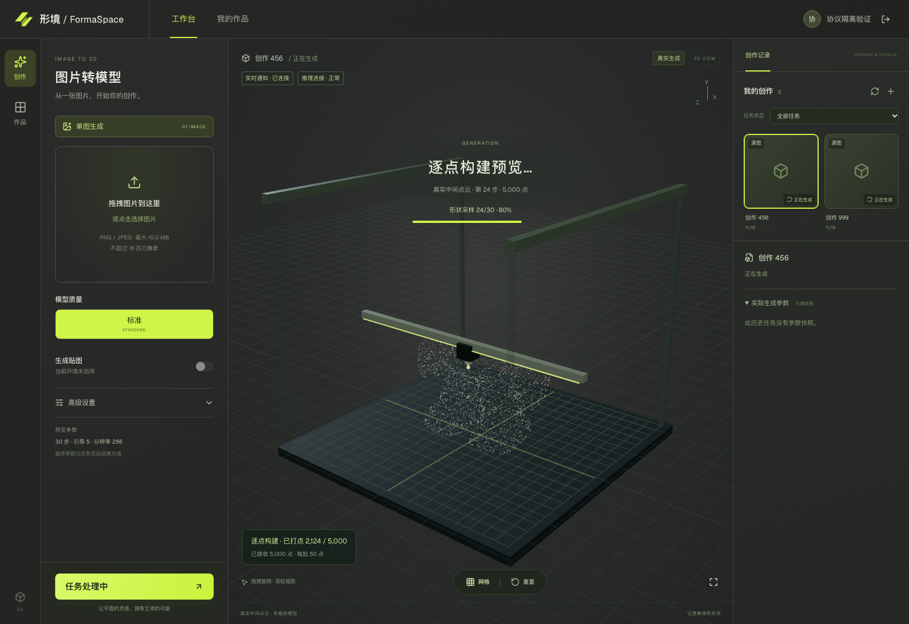

# 点云打印

工作台将真实中间点云显示为 3D 打印过程：打印平台、龙门架和打印头随落点移动，点逐渐保留在空间中，最终切换到 GLB。沿用 React / Three.js、原生 WebSocket 和 HTTP 恢复，不新增依赖。

## 数据与时序

Python 推理流程保持原样。当前配置在第 24/30 步完成同步预览解码后，才有真实表面采样的约 5000 个 XYZ；此前展示采样进度。Java 按高度分层、层内蛇形扫描排序，再将坐标每 50 个一批发送。排序不改变坐标，不丢点，不把 latent 当 XYZ。

订阅增加 `pointBatches: true`。`preview_ready` 先声明版本、完整点数、原始坐标包围盒和业务 sequence；后续 `point_batch` 使用 `baseSequence` 关联该声明，包含 offset、pointCount、positions。批次是控制帧，不占用业务 sequence。详见服务端 `docs/frontend-realtime-api.md` 第 13 节。

浏览器一次接收最多 50 点，默认按每秒 800 点逐点绘制；网络传输不按动画速度等待。打印头沿已收到的真实坐标移动。5000 点全部就绪时，完整打印约需 6.25 秒；最终 GLB 就绪后可以直接切换模型。减少动效设置下立即显示已收点，并隐藏移动打印装置。

同一预览版本复用一个预分配几何缓冲，通过 drawRange 增加点数。完整包围盒在第一批之前确定，后续不会逐批居中或缩放；原始模型坐标保留在数据层。界面分别显示已接收点数和已落点数。

## 恢复与兼容

- 匹配的重复批次忽略；缺批、冲突或两秒未收到完整批次时，通过受保护 HTTP 获取完整真实点云。
- 重连从任务快照和 HTTP 恢复当前完整预览，不要求服务器重放批次。
- HTTP 回退和旧式完整 `preview_ready` 均可显示。未启用 pointBatches 的旧客户端仍接收完整 positions。
- 批次数不影响业务进度、任务终态、previewVersion；不改变 Python 采样和最终 GLB。

## 验证（2026-11-18）

- 前端 `npm run build` 通过，未升级依赖。
- 本地 Chromium 受控 HTTP/WS 测试使用已有真实点云坐标：验证 50 → 5000 点、几何缓冲与坐标变换稳定、打印头移动、重复批次、缺批恢复、无批次超时恢复、最终 GLB 切换，无页面异常。该项是界面测试，不代表浏览器直接运行了真实生成任务。
- 独立 MySQL 与真实 Java 原生 WS：4 项测试通过。
- 真实 mini/MPS 推理 → Java → 原生 WS 客户端联调通过：5000 点、100 批、每批 50；与旧客户端完整点云和 HTTP 恢复文件坐标一致；最终 GLB 为 7,158,596 字节，重连恢复通过。
- Java 默认回归 183 项，159 项通过、24 项依环境跳过，无失败；真实模型测试为额外显式执行。

界面测试截图：

